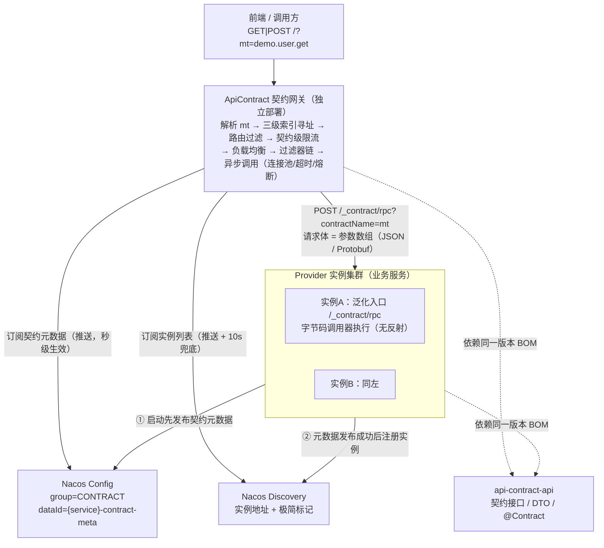
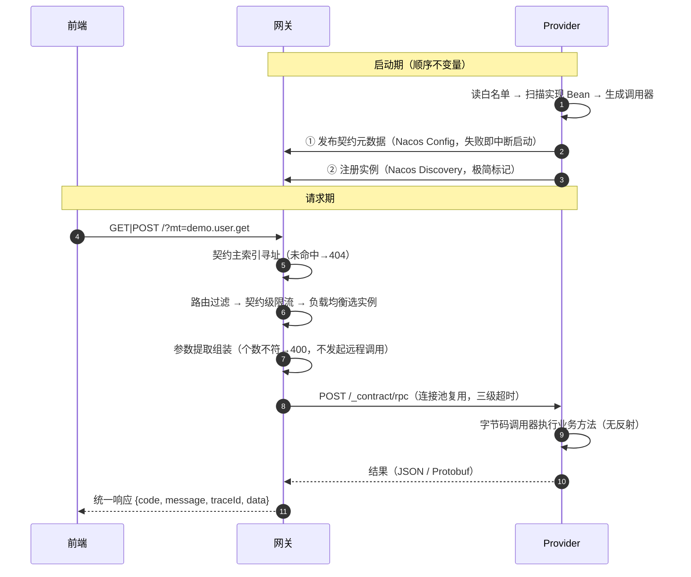
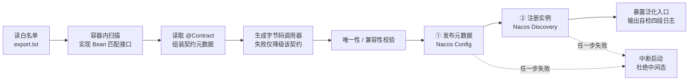

# ApiContract 契约网关

前端**只拼一个 `?mt=` 参数**即可调用任意后端能力——不感知服务名、接口路径、实例地址与版本细节。ApiContract 以「契约」为唯一寻址与治理单元，提供契约定义、元数据发布、泛化路由、高性能调用与全链路治理能力。

```bash
# 前端唯一要做的事：统一根路径 + mt 寻址（GET 读 / POST 写，按契约语义）
curl "http://gateway:18090/?mt=demo.user.get&userId=7&name=jiz"
# → {"code":"OK","message":"ok","traceId":"...","data":{"userId":7,"name":"jiz@demo"}}
```

## 核心特性

- **契约唯一定义源**：mt（契约标识）只声明在契约接口方法上（`@Contract("demo.user.get")`），实现类是普通 Spring Bean，零框架注解
- **白名单一票否决**：`META-INF/export.txt` 未列入的接口架构上不可达——不扫描、不发布、对外不可调用
- **统一泛化入口**：Provider 只暴露 `POST /_contract/rpc` 一个入口，按契约分发；网关统一根路径 + `mt` 参数寻址，无路径爆炸
- **运行期零反射**：启动期 ByteBuddy 生成调用器，运行期直接调用；`invoker.mode` 可一键切回反射排障
- **全链路异步**：网关 Reactor Netty 连接池（长连接复用、三级超时、有界等待队列），压测 QPS 达基线（反射+同步 HTTP）**6.29 倍**
- **双序列化**：前端 ↔ 网关恒 JSON（零改造）；网关 ↔ Provider 支持 Protobuf 契约级灰度，可独立回退
- **五级回退开关**：总开关 / 发布模式 / 调用器 / 序列化 / 异步客户端，全部可配置降级
- **秒级元数据生效**：契约元数据发布至 Nacos Config（`group=CONTRACT`），推送触发网关索引**原子替换**，刷新期间无错误尖刺

## 总体架构



**关键设计决策**：契约明细与实例元数据解耦（避免 metadata 容量限制与心跳滞后）；实例 metadata 仅携带 `contract-version`、`contract-count` 极简标记；网关本地维护三级索引（常驻堆内，推送原子替换）。

## 模块结构

| 模块 | 职责 |
| ---- | ---- |
| `api-contract-bom` | 版本统一管理（BOM，收录五件套） |
| `api-contract-api` | 契约接口 / DTO / `@Contract` 注解，无 RPC 依赖 |
| `api-contract-provider-starter` | 白名单加载、契约扫描、调用器生成、元数据发布、泛化入口、**内置启动编排（零编排代码接入）** |
| `api-contract-nacos-adapter` | 官方 Nacos 适配（可选）：配置中心元数据写入 + 实例注册/反注册自动装配，原生 nacos-client |
| `api-contract-gateway-starter` | 三级索引、实例注册表、路由限流熔断、异步远程调用 |
| `api-contract-it` | 全链路集成测试（发布顺序守卫、降级矩阵、多版本寻址、零编排端到端等） |
| `api-contract-samples` | 端到端示例：demo-provider（三步接入零编排代码）+ demo-gateway + demo-frontend |

## 调用链路



> 调用链顺序固定：**路由 → 限流 → 负载均衡 → 调用 → 容错**，不可配置打乱（有顺序断言测试守护）。失败时按集群策略容错：failover（默认，重试 2 次换实例，仅框架级异常重试）/ failfast / failsafe。

## Provider 启动流程



自检四段结构化日志（上线验收依据）：`export loaded` → `contract ready`（逐契约）→ `meta published` → `registry joined`。

## 三步接入（Provider 侧）

业务接入 = **1 依赖（provider-starter）+ 三步代码 + 少量配置**：启动编排（白名单→扫描→调用器→发布→注册→优雅反注册）由 Starter 内置完成，**零编排代码**；nacosConfig 正式发布模式可选引入官方 Nacos 适配模块（`api-contract-nacos-adapter`）并配置地址即可。已按旧手抄形态接入的业务声明编排组件即自动禁用内置编排（升级指南见 `api-contract-samples/README.md` 第五节）。

**第①步：定义契约接口**——mt 声明在方法上（`业务域.动作`，全小写点分层，全局唯一）：

```java
public interface UserContractApi {

  /** mt 是前端唯一感知的调用凭据。 */
  @Contract("demo.user.get")
  UserDto getUser(Long userId, String name);
}
```

**第②步：加入导出白名单**——`src/main/resources/META-INF/export.txt`（每行一个接口全限定名，`#` 注释；未列入 = 架构上不可达）：

```text
com.apicontract.samples.provider.user.UserContractApi
```

**第③步：编写实现类**——普通 Spring Bean，不写契约注解、不写框架注解：

```java
@Service
public class UserServiceImpl implements UserContractApi {

  @Override
  public UserDto getUser(Long userId, String name) {
    return new UserDto(userId, name + "@demo");
  }
}
```

**前端调用**（零改造，GET/POST 均可）：

```bash
# GET：参数按名从 query 取值
curl "http://127.0.0.1:18090/?mt=demo.user.get&userId=7&name=jiz"
# POST：参数按名从 JSON 对象取值，或直接传参数数组 [9, "array"]
curl -X POST "http://127.0.0.1:18090/?mt=demo.user.get" \
  -H 'Content-Type: application/json' -d '{"userId":8,"name":"fe"}'
```

> 完整可运行示例见 `api-contract-samples/`，`./run-demo.sh` 一键从零跑通（本机 Nacos 8848；无 Nacos 时 provider 可用 `publish-mode=logOnly` 零依赖启动）。

## 方案关键点

### 1. 三级索引与原子替换

| 索引 | 键 | 值 | 用途 |
| ---- | ---- | ---- | ---- |
| 契约主索引 | mt | ContractMeta | 请求寻址 |
| 服务索引 | serviceName | 契约标识集合 | 发布校验、批量刷新 |
| 版本索引 | mt + version | ContractMeta | 版本路由、灰度 |

配置推送按**服务维度原子替换**索引条目（清理已删契约），刷新期间无请求错误尖刺；契约变更与实例变动分离刷新，互不触发全量重建。空实例结果短缓存 1s 防击穿；实例列表刷新失败沿用最近快照、不清空。

### 2. 发布顺序不变量（一致性核心）

**先发布契约元数据、后注册实例；任一步失败中断启动**——从机制上杜绝「实例已上线但契约缺失」的中间态。实例注册句柄由容器持有，应用关闭时优雅反注册。并发发布按版本号/内容哈希乐观比较，旧内容不覆盖新内容。

### 3. 运行期零反射（字节码调用器）

启动期按契约生成调用器（SPI：`ContractInvokerFactory`，内置 bytecode / reflection 两种），运行期直接方法调用：

```java
// 调用器抽象：生成后调用零反射开销，参数按名分发（依赖 -parameters 编译）
public interface ContractInvoker {
  Object invoke(Object[] args) throws Throwable;
}
```

单契约生成失败仅降级该契约（或切反射），不影响其他契约；`api-contract.invoker.mode=reflection` 可一键整体回退排障。契约方法**禁止重载**（参数按名分发的前提，扫描期强制拒绝）。

### 4. 全链路异步与三级超时

网关采用 Reactor Netty `HttpClient` + `ConnectionProvider`：请求线程只做解析与组装，IO 等待由事件循环承担，回调线程只做结果封装（禁止阻塞）。连接池按目标地址维护长连接（max-connections / max-idle / acquire-timeout 有界等待、超限快速失败不排队放大）。三级超时：连接超时 / 读超时 / 整体调用超时（默认 3000ms，契约级 `timeout` 覆盖）。未引入异步依赖时自动降级同步实现并告警。

### 5. 双序列化（契约粒度灰度）

前端 ↔ 网关**恒 JSON**；网关 ↔ Provider 按契约元数据 `serializer` 字段选择 JSON / Protobuf。新契约先 JSON 上线验证 → 补 Protobuf schema（接口与 DTO 不变）→ 元数据声明切换；异常按契约粒度回退 JSON。两侧序列化声明不一致时启动校验失败。

### 6. 限流熔断（自研轻量 SPI，可替换 Sentinel）

- **限流**：契约级 `ContractRateLimiter` SPI（内置令牌桶/漏桶），不同契约独立，防单契约拖垮整体
- **熔断**：`ContractCircuitBreaker` SPI，按**契约 + 实例**维度统计失败率（failure-rate=0.5、min-request=20），半开探测恢复
- 本期不引入 Sentinel/Redis 等重依赖；业务可经 SPI 无缝接入

### 7. 五级回退开关

| 开关 | 配置 | 回退方向 |
| ---- | ---- | ---- |
| 能力总开关 | `api-contract.rpc.enabled` | 关闭即整体下线 |
| 元数据发布模式 | `api-contract.meta.publish-mode` | nacosConfig → nacosMetadata → logOnly |
| 调用器模式 | `api-contract.invoker.mode` | bytecode ↔ reflection |
| 序列化方式 | 契约元数据 `serializer` | protobuf → json（契约粒度） |
| 异步客户端 | 依赖引入与否 | 移除依赖自动降级同步 |

### 8. 统一错误码（不泄漏内部堆栈）

网关侧：`MT_MISSING`(400) / `CONTRACT_NOT_FOUND`(404) / `ARGUMENT_INVALID`(400) / `NO_INSTANCE`(503) / `RATE_LIMITED`(429) / `SERIALIZE_ERROR`(400) / `INVOKE_ERROR`(502) / `CIRCUIT_OPEN`(503) / `TIMEOUT`(504) / `UPSTREAM_UNAVAILABLE`(503)。Provider 侧异常剥离代理/反射包装后仅返回码 + 消息 + traceId。

### 9. 可观测性

契约维度 QPS / RT / 错误率 / 熔断次数 / 重试次数 / 连接池使用率指标；索引刷新耗时（推送至生效）；traceId 经过滤器链透传两侧关联；发布自检四段日志作为上线验收断言。

## 快速开始

```bash
# 1. 构建 + 全部测试（含集成测试，9 模块）
./.tools/apache-maven-3.9.6/bin/mvn clean verify

# 2. 端到端示例（需本机 Nacos 8848；自动清残留、自检、调用断言、优雅清理）
cd api-contract-samples && ./run-demo.sh

# 3. 仅前端视角验证（网关已启动时）
./demo-frontend/call-demo.sh http://127.0.0.1:18090
```

压测验收（`ContractBench`，基线=反射+同步 HTTP vs 优化=字节码+Reactor Netty，同 JVM 交替）：**QPS 比值 6.29×（红线 1.5×）、P99 超时率 0%、索引刷新无尖刺（P99 劣化 1.20× ≤ 2×）**，报告见 `openspec/changes/archive/2026-11-15-add-contract-gateway/bench/benchmark-report.md`。

## 已知边界（本期范围外）

- 本期不做鉴权与契约级授权（已预留过滤器/SPI 扩展点；泛化入口限内网访问 + 契约级限流）
- 不引入 MySQL / Redis / RocketMQ / Seata / Sentinel（框架无业务状态）
- 不做内嵌网关形态与跨语言 SDK；不做私有二进制协议

## 文档索引

- 能力规格基线（8 个能力）：`openspec/specs/contract-{definition,metadata,provider-invoke,gateway-routing,serialization,async-stability,spi-extension,starter-access}/spec.md`
- 技术方案与提案（归档）：`openspec/changes/archive/2026-11-15-add-contract-gateway/`
- 示例与三步接入指南：`api-contract-samples/README.md`
- 上游设计文档：《契约网关.md》（项目根目录）
