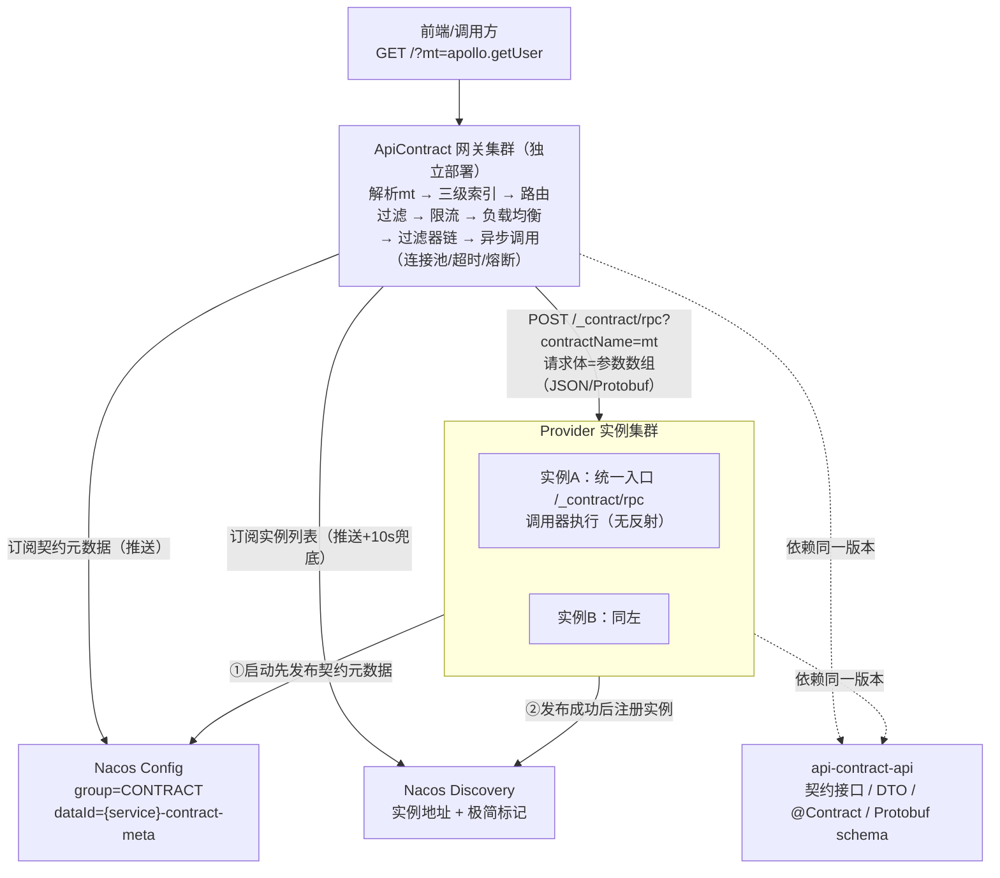

# 技术方案：ApiContract 契约网关 v2.0（契约唯一寻址与治理）

<!--
本方案基于前面Proposal、Spec评审结论编写；
只在Proposal、Spec评审通过之后才进入本阶段；
方案评审对齐后再开发，禁止在CR阶段讨论架构、方案分歧。
-->

## 上下文
- **关联提案**：`openspec/changes/add-contract-gateway/proposal.md`（已评审通过，4 项决策闭环）
- **关联规格**（8 个能力路径）：`contract-definition`、`contract-metadata`、`contract-provider-invoke`、`contract-gateway-routing`、`contract-serialization`、`contract-async-stability`、`contract-spi-extension`、`contract-starter-access`
- **上游设计文档**：《契约网关.md》v2.0（2026-11-14，本方案的技术权威来源）
- **已确认决策**（硬约束）：①全量四阶段 ②独立网关为默认形态（保留单机调试）③前端↔网关固定 JSON，Protobuf 仅网关↔Provider 链路 ④本期不做鉴权，仅预留扩展点
- **业务背景**：绿地工程，无存量代码、无存量数据、无迁移负担；首次引入契约能力
- **架构约束**：Spring Boot 3 自动装配；Nacos Config/Discovery；注册中心客户端版本由业务统一管理（Starter 以 provided/optional 声明）
- **与模板默认技术栈的差异声明**：模板默认含 MySQL/RocketMQ/Seata/Redis/Sentinel，本变更为**基础框架能力**，不承载业务状态与业务逻辑，**不引入上述组件**（网关不聚合、不改写业务语义）；限流熔断采用自研轻量 SPI 实现（见选型对比第 5 项）

## 目标 & 非目标
✅ 技术目标
- 网关单机 QPS 不低于优化基线 1.5 倍；P99 在契约级超时内完成，超时率 < 0.1%
- 契约索引经配置推送秒级生效，刷新期间无请求错误尖刺
- 运行期调用零反射（字节码调用器，保留反射降级开关）
- 连接复用率达标，连接创建速率稳定
- 全链路可观测：契约维度 QPS/RT/错误率/熔断/重试/连接池指标 + traceId 两侧透传
- 全部关键策略 SPI 可扩展、可灰度、可回退（发布模式/调用器/序列化/异步/总开关五级开关）

❌ 本次不做的技术改造
- 不引入 MySQL / Redis / RocketMQ / Seata / Sentinel（框架无业务状态，见差异声明）
- 不做自研私有二进制协议（极限吞吐优化路径，等同重做调用层）
- 不做鉴权过滤器内置实现与契约级授权（仅预留过滤器/SPI 扩展点）
- 不做内嵌网关形态与跨语言 SDK

## 方案选型与对比
1. **契约元数据存储**
   - 方案A（旧模型）：契约明细挂每实例 metadata——优点：无额外组件；缺点：容量受 metadata 长度限制、网关遍历实例解析 CPU 高、变更随心跳滞后
   - 方案B（选定）：Nacos Config 按服务一份——优点：推送秒级生效、容量大幅放宽、契约与实例解耦；缺点：启动期强依赖配置中心（已设计降级）
   - **最终选型：B**，发布方式 SPI 可回退（nacosConfig / nacosMetadata / logOnly）
2. **Provider 方法调用方式**
   - 方案A：运行期 `Method.invoke` 反射——优点：实现简单；缺点：每次调用反射开销、装箱
   - 方案B（选定）：启动期字节码生成调用器，运行期直接调用——优点：消除反射开销；缺点：生成类进入异常栈、禁止重载
   - **最终选型：B**，`api-contract.invoker.mode` 可一键切回反射排障；单契约生成失败仅降级该契约
3. **字节码库**：ByteBuddy（声明式 API、维护成本低）优于裸 ASM（灵活但开发维护成本高）；调用器抽象 `ContractInvoker#invoke(Object[]) -> Object`，生成器为 SPI（内置 bytecode / reflection 两种）
4. **网关异步客户端**
   - 方案A：同步阻塞客户端——优点：简单；缺点：线程阻塞、频繁建连
   - 方案B（选定）：Reactor Netty 全链路非阻塞 + 连接池——优点：吞吐与连接稳定性提升；缺点：复杂度高、回调禁阻塞
   - **最终选型：B**，声明为可选依赖，未引入时降级同步实现并告警
5. **限流熔断**
   - 方案A：引入 Sentinel——优点：功能全；缺点：重量级依赖、与"框架不承载业务、SPI 可替换"定位冲突
   - 方案B（选定）：自研轻量 SPI 实现（令牌桶/漏桶限流、失败率熔断+半开探测）——优点：按契约+实例维度细粒度、零侵入、业务可经 SPI 接入 Sentinel
   - **最终选型：B**
6. **序列化**
   - 方案A：仅 JSON——优点：可读、前端零改造；缺点：包体积与编解码开销大
   - 方案B（选定）：双序列化 SPI（JSON 默认 + Protobuf 契约级灰度）——优点：按契约渐进优化、可独立回退；缺点：两侧一致性需启动校验
   - **最终选型：B**（前端↔网关恒 JSON，决策③）

## 架构设计
### 总体架构

### 模块依赖
`api-contract-bom` 统一管理版本 → `api-contract-api`（仅接口/DTO/注解/schema，无 RPC 依赖）← `api-contract-provider-starter` / `api-contract-gateway-starter`（默认推荐双 Starter 依赖隔离；单一 Starter 可按 `api-contract.role` 切换）
### 调用链路（网关，顺序不变量）
解析 mt（缺失→400）→ 契约主索引（未命中→404）→ 取实例列表（空→503）→ 路由过滤（版本/标签/灰度）→ 契约级限流（拒绝→429）→ 负载均衡选实例 → 参数提取组装（个数不符→400，不发起远程调用）→ 过滤器链前置（trace/日志/指标；鉴权预留）→ 连接池异步调用 → 集群策略容错（failover 默认重试 2/failfast/failsafe）→ 过滤器链后置、异常收敛 → 返回。**顺序固定：路由 → 限流 → 负载均衡 → 调用 → 容错，不可配置打乱。**
### 同步/异步拆分
请求线程只做解析与组装；IO 与等待由事件循环承担；回调线程完成结果封装与返回，回调中禁止阻塞操作。
### 三级索引结构
| 索引 | 键 | 值 | 用途 |
| ---- | ---- | ---- | ---- |
| 契约主索引 | mt | ContractMeta | 请求寻址 |
| 服务索引 | serviceName | 契约标识集合 | 发布校验、批量刷新 |
| 版本索引 | mt + version | ContractMeta | 版本路由、灰度 |
### Provider 启动流程（10 步）
读白名单 → 遍历 Bean 取真实类型匹配接口 → 读取 @Contract → 定位实现方法组装元数据 → 生成调用器（失败降级）→ 注册调用器缓存 → 唯一性/兼容性校验 → **发布元数据到配置中心** → **注册实例写极简标记** → 暴露泛化入口输出自检日志

## 存储设计
### MySQL 表变更
- **不涉及**：框架不持有业务数据，无库表
### 配置中心（Nacos Config）存储设计（核心存储）
- 布局：`group=CONTRACT`，`dataId={serviceName}-contract-meta`（多版本推荐后缀隔离 `{serviceName}-contract-meta-{version}`；单配置多版本按 mt+version 区分）
- 内容结构：
```json
{
  "serviceName": "user-provider",
  "version": "1.0.0",
  "contracts": [
    { "contractName": "apollo.getUser", "interfaceName": "com.apicontract.api.UserContract",
      "methodName": "getUser", "paramNames": ["userId"], "paramTypes": ["java.lang.Long"],
      "returnType": "com.apicontract.api.UserDTO", "serviceName": "user-provider",
      "version": "1.0.0", "tags": [], "serializer": "json", "schemaRef": null, "timeout": null }
  ]
}
```
- 覆盖策略：发布时按版本号/内容哈希乐观比较，旧内容不覆盖新内容
- 容量：按服务拆分多份配置；单服务契约数设阈值告警
### 注册中心（Nacos Discovery）
- 实例 metadata 仅极简标记：`contract-version`、`contract-count`，**不携带契约明细**
### 本地缓存（Caffeine，网关侧）
- 契约三级索引：常驻堆内，配置推送触发服务维度**原子替换**（清理已删契约），不整表刷新
- 实例地址列表：推送刷新 + 10s 兜底定时校准；刷新失败沿用最近快照、不清空
- 空实例结果短缓存 1s（防击穿）
- 契约条目设上限并监控淘汰
### Redis 缓存设计
- **不涉及**（无共享缓存需求，本地索引即权威快照）
### ES/其他存储
- **不涉及**

## 接口契约
### 网关入口（前端唯一入口）
- `http(s)://gateway:{port}/`，统一根路径；契约标识 query 参数 `mt` 必填；读类 GET / 写类 POST 以契约为准
- 参数提取：GET 按参数名从 query 取首值（缺省 null）；POST 按参数名从 JSON 对象取值或直接为参数数组（长度须等于参数个数）；无参契约忽略请求体
- 前端侧恒 JSON（决策③）；`mt` 仅网关寻址，不透传 Provider
- 统一错误结构：`{ "code": "...", "message": "...", "traceId": "...", "data": null }`
- 错误码：MT_MISSING(400) / CONTRACT_NOT_FOUND(404) / ARGUMENT_INVALID(400) / NO_INSTANCE(503) / RATE_LIMITED(429) / SERIALIZE_ERROR(400) / INVOKE_ERROR(502) / CIRCUIT_OPEN(503) / TIMEOUT(504) / UPSTREAM_UNAVAILABLE(503)
### Provider 泛化入口
- `POST {context-path}/_contract/rpc?contractName={mt}`（路径可配置避让业务路径）；请求体为参数数组，按契约 `serializer` 编码
- 错误码：CONTRACT_NOT_FOUND / CONTRACT_ARGUMENT_INVALID / CONTRACT_INVOKE_ERROR（剥离代理包装取真实异常）/ CONTRACT_INTERNAL_ERROR；只返回码+消息+traceId，不返回堆栈
### 契约注解与元数据
- `@Contract(value)` 仅允许标注接口方法；元数据字段：contractName、interfaceName、methodName、paramNames、paramTypes、returnType、serviceName、version、tags、serializer(json/protobuf)、schemaRef、timeout
- 版本兼容：签名变更（含新增可选参数）= 破坏性变更，必须新增版本并保留旧版本至下线；仅返回体新增字段 = 兼容变更沿用同版本；兼容性检查在发布阶段完成，不兼容拒绝发布

## 异步流程设计（无 MQ，异步指网关调用链路）
> 本变更不引入消息队列；"异步"指网关→Provider 调用链路全非阻塞。
- 客户端：Reactor Netty `HttpClient` + `ConnectionProvider`，事件循环模型，全链路非阻塞
- 连接池：按目标地址维度维护长连接 keep-alive 复用；参数：max-connections=500、每主机连接上限、max-idle=30s、acquire-timeout=1000ms；**等待队列有界，超限快速失败不排队放大**
- 三级超时：连接超时 / 读超时 / 整体调用超时（默认 3000ms，契约级 `timeout` 覆盖）
- 回调线程：完成结果封装与返回，禁止阻塞操作（评审阻断项）
- 失败处理：集群策略 failover（默认，重试 2 次、换实例、仅框架级异常重试）/ failfast / failsafe；重试不绕过路由链
- 降级：未引入异步依赖时自动降级同步实现并告警，功能不缺失

## 分布式事务 & 一致性策略
> 不引入分布式事务组件（网关无业务数据写入）。一致性靠以下不变量保障：
1. **发布顺序不变量**：先发布契约元数据、后注册实例；任一步失败**中断启动**，杜绝"实例已上线但契约缺失"中间态
2. **并发发布防覆盖**：发布前按版本号/内容哈希比较，旧内容不覆盖新内容
3. **索引原子替换**：配置推送解析后按服务维度原子替换索引条目，刷新期间无请求错误尖刺
4. **双索引分离**：契约变更只刷新契约索引，实例变动只刷新地址列表，互不触发全量刷新
5. **序列化声明一致性**：网关与 Provider 对同一契约 serializer 不一致时启动校验失败
6. **对账等价物**：发布自检日志四段（export loaded / contract ready / meta published / registry joined）+ 聚合索引跨服务判重，作为上线验收与回归断言依据

## 限流、熔断、降级（自研轻量 SPI，可经 SPI 替换为 Sentinel）
- **限流**：契约级，SPI `ContractRateLimiter`，内置令牌桶/漏桶；拒绝返回 429 RATE_LIMITED；不同契约限流独立，防单契约拖垮整体
- **熔断**：SPI `ContractCircuitBreaker`，按**契约+实例**维度统计失败率；阈值 failure-rate=0.5、min-request=20；超阈值短路返回 503 CIRCUIT_OPEN，半开探测恢复
- **降级矩阵**：

| 故障 | 表现 | 降级 |
| ---- | ---- | ---- |
| 配置中心不可用（启动期） | 索引无法构建 | 启动直接失败，明确报错 |
| 配置中心不可用（运行期） | 索引无法更新 | 沿用本地索引，恢复后增量补齐 |
| 服务发现不可用 | 实例列表无法更新 | 沿用最近快照；持续失效返回上游不可用 |
| 单实例异常 | 调用失败 | failover 换实例；超阈值熔断该实例 |
| 连接池耗尽 | 获取连接超时 | 快速失败返回明确错误码，不排队 |
| 调用器生成失败 | 单契约不可用 | 降级反射调用器或标记不可用，不影响他契约 |
| 编解码失败 | 请求失败 | 返回明确错误码，禁止静默空结果 |

- 热点防护：空实例结果 1s 缓存防击穿；契约条目上限监控淘汰

## 数据迁移 & 灰度策略
- **无存量数据迁移**（绿地工程，无脚本、无双写、无切流）
- **灰度维度与开关（五级）**：

| 开关 | 配置 | 回退方向 |
| ---- | ---- | ---- |
| 能力总开关 | `api-contract.rpc.enabled` | 关闭即整体下线 |
| 元数据发布模式 | `api-contract.meta.publish-mode` | nacosConfig → nacosMetadata → logOnly |
| 调用器模式 | `api-contract.invoker.mode` | bytecode ↔ reflection |
| 序列化方式 | 契约元数据 `serializer` | protobuf → json（契约粒度） |
| 异步客户端 | 依赖引入与否 | 移除依赖自动降级同步 |

- **实施节奏 = 灰度节奏**：四阶段按验收标准推进；阶段三与阶段四之间插入全链路压测检查点，确认元数据重构与字节码调用实际收益后再推进异步改造
- **新契约上线流程**：JSON 上线验证 → 补 Protobuf schema（接口与 DTO 不变）→ 元数据声明切换 → 异常按契约粒度回退 JSON

## 风险点、降级、回滚方案
> 重点：必须明确回滚路径，上线前确认可回滚
| 风险 | 影响等级 | 降级方案 | 回滚方式 |
| ---- | -------- | -------- | -------- |
| 发布顺序不变量被破坏（实例在而契约缺） | 高 | 启动中断禁止中间态；网关对契约缺失返回明确错误码 | 修复后重启；无数据残留 |
| 契约标识跨服务冲突 | 高 | 发布期聚合索引校验，冲突中断启动 | 修正标识后重新发布 |
| 契约被误删（配置删除即不可达） | 高 | 变更纳入评审；保留版本后缀至确认下线 | 配置中心历史版本回滚（Nacos config 历史回退） |
| 序列化两侧不一致 | 中 | 元数据声明 + 启动校验失败 | 契约元数据 serializer 回退 json |
| 白名单静态性（增量需重扫/重启） | 中 | 提供重新扫描管理端点，纳入发布流程 | 重启或触发重扫 |
| 异步链路回调阻塞/超时配置不当 | 中 | 禁止回调阻塞（CR 阻断）；三级超时统一配置 | 配置回调超时；降级同步客户端 |
| 泛化入口暴露面（可调全部导出契约且无鉴权） | 高 | 内网访问限制 + 契约级限流 + 过滤器预留鉴权扩展点 | 网络策略收敛建议尽快补鉴权迭代 |
| api-contract-api 版本漂移 | 中 | BOM 统一 + 发布前兼容性检查 | 回退 BOM 版本 |
| 调用器生成失败 | 低 | 单契约降级反射或标记不可用 | `invoker.mode=reflection` |
| 配置中心不可用 | 中 | 启动失败/运行期沿用本地索引 | Nacos 恢复；logOnly 模式应急 |
| 连接池耗尽 | 中 | 有界队列快速失败 | 调大 max-connections / 排查慢契约 |

## 监控、日志、告警
- **日志**：发布自检四段结构化日志、调用器生成结果（逐契约）、元数据推送、实例刷新、契约级调用日志；完整堆栈仅本地日志并关联 traceId
- **指标（Metrics）**：契约维度 QPS / RT / 错误率 / 熔断次数 / 重试次数 / 连接池使用率；索引刷新耗时（推送至生效，目标秒级）
- **追踪**：traceId 经过滤器链透传至 Provider，两侧日志可关联
- **告警**：契约发布失败、索引刷新失败、熔断打开、连接池耗尽、超时率异常（>0.1%）、单服务契约数超阈值；接收人：框架负责人 + 网关值班

## 测试方案
- **单元测试**：白名单解析（注释/空行/非接口/类不存在 fail-fast）、@Contract 扫描与元数据组装（重载拒绝/签名不一致跳过/多实现冲突）、唯一性与兼容性校验、参数提取与类型转换（日期/枚举/金额/集合/DTO）、三级索引原子替换与清理、路由/负载均衡（轮询/随机/一致性哈希/加权）/集群策略/熔断半开/限流、SPI 加载与业务覆盖、错误码映射
- **集成测试**：内嵌/Testcontainers Nacos 全链路（Provider 发布→网关订阅→泛化调用成功）；12 类错误码逐场景触发；降级矩阵逐项验证；发布顺序破坏场景（模拟发布失败断言不注册实例）；多版本共存寻址；单机调试模式；序列化契约级切换与回退
- **压测要求**：基线组（反射+JSON+同步）vs 优化组（字节码+双序列化+异步）对照压测；验收：单机 QPS ≥ 基线 1.5 倍、P99 超时率 < 0.1%、连接复用率达标、索引刷新无错误尖刺；阶段三后执行全链路压测
- **对账校验逻辑**：无业务对账；以发布自检日志断言 + 聚合索引判重断言 + 网关索引与配置中心内容一致性抽检代替

## CR评审检查清单（blocker / 建议项，直接用于PR评审）
🔴 阻断项（不满足不能合并）
- 发布顺序不变量（先元数据后实例、失败中断启动）必须有测试覆盖
- 契约标识冲突校验与同版本签名兼容校验必须在发布期强制执行，不可绕过
- 白名单一票否决语义：未列入接口不得被扫描/发布/可达，需有反向测试
- 回滚开关齐备且可验证：总开关/发布模式/调用器/序列化/异步 五级均有配置回退测试
- 错误响应不得泄漏内部堆栈（INVOKE_ERROR 须剥离代理/反射包装）；敏感字段按契约约定脱敏
- 参数个数校验必须在发起远程调用前完成（网关侧拦截）
- 调用链顺序（路由→限流→LB→调用→容错）不可配置打乱，需有顺序断言测试
- 连接池等待队列必须有界，acquire-timeout 快速失败，禁止无限排队
- 回调线程禁止阻塞操作（代码评审 + 必要时线程阻塞检测测试）
- 索引刷新必须原子替换，刷新期间无请求错误尖刺（并发刷新测试）
- 契约方法禁止重载、编译必须开启 `-parameters`，需落入构建期校验（enforcer/编译参数检查）
- 泛化入口内网访问限制生效；本期无鉴权需在发布单中显式声明风险
- 限流/熔断默认配置齐全（429/503 语义正确、契约级独立生效）

🟡 优化建议项（不阻塞合并，登记issue后续迭代）
- 鉴权过滤器与契约级授权（下一迭代优先级最高）
- 重新扫描管理端点的访问收敧行政管控
- Protobuf 契约占比观测面板与序列化收益报表
- 一致性哈希负载均衡的会话亲和场景评估
- 调用器启动生成耗时的启动监控指标
- 网关契约条目容量的动态告警阈值（按业务规模自适应）

## 上线步骤
1. **配置/脚本先行**：创建 Nacos `group=CONTRACT` 分组与命名空间；发布 `api-contract-bom` 与 `api-contract-api` 至制品库；部署独立网关集群（默认形态）并验证订阅正常
2. **灰度放量**：首个业务服务以 `publish-mode=logOnly` 试点（验证扫描与自检日志）→ 切 `nacosMetadata`（验证旧链路）→ 切 `nacosConfig`（正式链路）；序列化全程 JSON；调用器先 reflection 试点观察后切 bytecode；每步观察自检日志四段与指标
3. **全量上线**：按四阶段验收标准推进（阶段一契约基座 → 阶段二元数据重构 → 阶段三调用与序列化优化 → **全链路压测检查点** → 阶段四异步与稳定性）；各阶段回滚开关保持可用
4. **上线后观测窗口**：24h~72h 观察契约维度 QPS/RT/错误率/熔断/重试/连接池指标与告警；确认索引推送秒级生效、无错误尖刺后关闭试点标记

## 方案备注
- 本方案与规格阶段已确认决策严格一致：全量四阶段、独立网关、前端固定 JSON、本期不做鉴权；若开发中发现分歧，退回本方案重新对齐，禁止私自抹平
- 与模板默认技术栈差异（不引入 MySQL/Redis/MQ/Seata/Sentinel）已在"上下文"声明，评审时确认
- 已知事项（非阻塞）：openspec 内置 validate 按 spec-driven delta 格式检查会报格式类 ERROR/WARNING，属校验器与 cust-schema 模板差异，以 `openspec status` 工件状态为准
- 协同方：前端（仅拼接 `?mt=`，零改造）、业务服务团队（三步接入）、运维（Nacos 分组/网关部署/内网策略）
- 排期对齐设计方案四阶段：阶段三与阶段四之间插入全链路压测检查点
